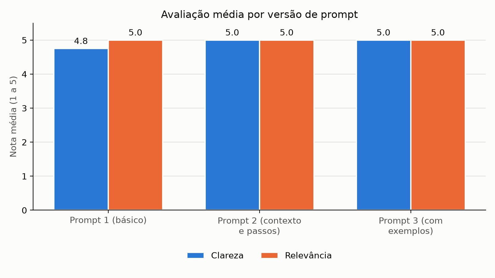

# Document Q&A with the Gemini API and prompt engineering

A prototype that answers questions about a reference text using only that text, and says so when the answer is not there. It compares three prompt versions and applies basic LLMOps practices. Built for Module 4 (Generative AI and interaction with language models) of the AI Specialisation at Tokio School.

> The notebook is written in European Portuguese, as it was submitted for the course.

## What it does

- Sends a reference text and a question to Google Gemini (`google-genai` library) and returns an answer based only on that text.
- **Four fixed questions:** extract a list, reproduce a definition, compare two concepts, and one question whose answer is **not** in the text (to check that the model does not invent one).
- **Three prompt versions**, each adding techniques to the previous one:
  1. Basic, zero-shot.
  2. Role, delimited context, step-by-step instructions, a three-sentence limit and a fixed reply when the answer is missing.
  3. Everything in prompt 2, plus two few-shot examples on another topic.
- **Multimodal test:** an image and the text are sent together, and the model is asked to compare them.
- Each answer was rated by hand from 1 to 5 for clarity and relevance.

## LLMOps practices

- **Logging:** every interaction and every API attempt is written to CSV (`registo_interacoes_T4.csv`, `registo_tentativas_T4.csv`).
- **Prompt versions** saved to JSON (`versoes_prompts_T4.json`).
- **Reliability:** temporary errors (429, 500, 503, 504) are retried up to three times with growing waits, with a fixed pause between requests to respect the free tier's per-minute limit.
- **The API key** is read from the `GEMINI_API_KEY` environment variable and is never written in the code.

## Results (final run submitted for the course)

- 14 API calls, all successful on the first attempt. Average response time 4.0 s.
- Average clarity: 4.75 (prompt 1), 5.00 (prompt 2), 5.00 (prompt 3). Relevance was 5.0 for all three.
- Prompts 2 and 3 gave shorter answers (about 27 words against 53) and followed the format rules.
- **No prompt invented an answer** to the question with no answer in the text.
- Prompt 3's examples brought no measurable gain over prompt 2 in this small sample.
- Even so, prompt 1 added two details in one answer that are not in the text. Relevance alone did not catch this, so a faithfulness check is the main improvement for a next round.



## Files

- `gemini_document_qa.ipynb`: the notebook, with the outputs of the final run.
- `versoes_prompts_T4.json`, `registo_interacoes_T4.csv`, `registo_tentativas_T4.csv`: the logs of that run.
- `grafico_comparacao_prompts_T4.png`: the comparison chart.

**Not included:** the reference text (`excerto_UD3_LLMOps.txt`) and the image used in the multimodal test (`figura_4_ciclo_de_vida.png`) are Tokio School course material, so they are not published here. To run the notebook, add your own text and image under those two file names.

## How to run

1. Get a Gemini API key from Google AI Studio. The free tier has daily request limits.
2. Set it as an environment variable called `GEMINI_API_KEY`.
3. Install the dependencies:
   ```
   pip install -r requirements.txt
   ```
4. Add the reference text and image (see above) and run all cells.
